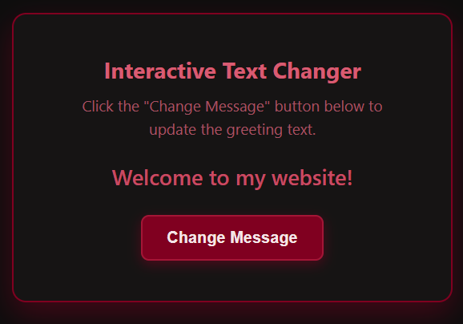
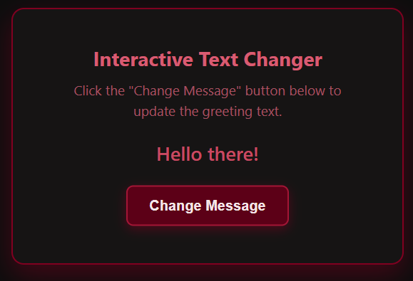
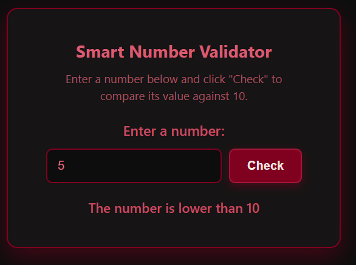
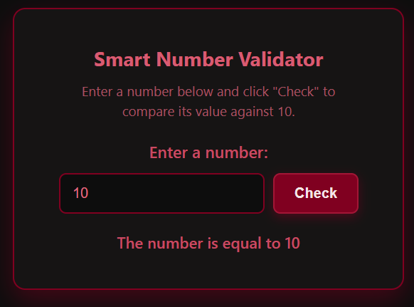
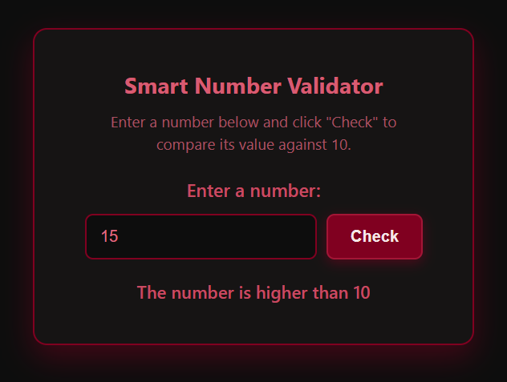
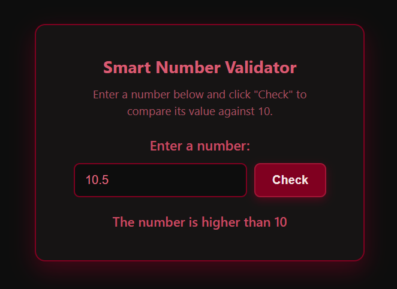
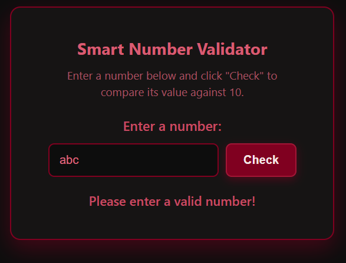
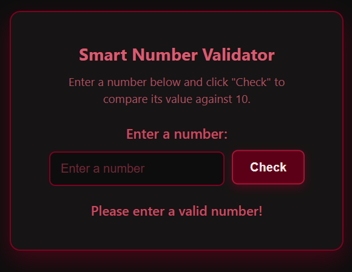
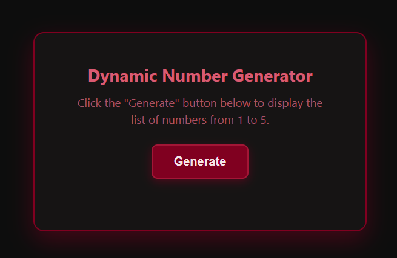
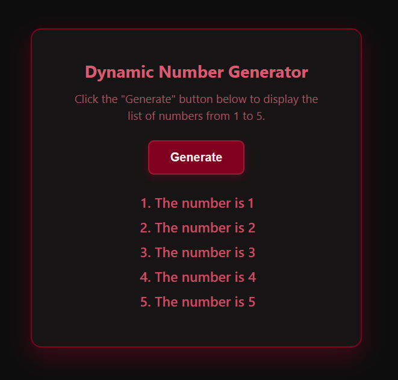

# BIC21203 - Lab 4a: Client-Side Scripting (JavaScript)

**Name:** ANIS NAJEHA BINTI SHAMSUDDIN  
**Student ID:** CI250074 
**Course:** BIC21203 Web Development  

---

## Brief Explanation
This repository contains client-side JavaScript implementations for Lab 4a, demonstrating DOM manipulation, event handling (`addEventListener`), input validation using conditional statements (`if...else if...else`), and dynamic HTML element generation using `for` loops.

---

## Instructions to Run Each Question
1. Clone or download this repository to your local computer.
2. Open the respective folder (`Q1`, `Q2`, or `Q3`).
3. Double-click `index.html` (or open it with any modern desktop web browser such as Chrome, Edge, or Firefox).
4. Interact with the buttons and input fields on each page to observe the output.

---

## Output Screenshots

### Question 1: Interactive Text Changer (`Q1/`)
**Before Click:**  

**After Click:**  

---

### Question 2: Smart Number Validator (`Q2/`)
**Before Input:**  

**After Input (`5`, `10`, `15`, `10.5`, `abc`, Empty):**  

---

### Question 3: Dynamic Number Generator (`Q3/`)
**Before Click:**  

**After Click:**  
